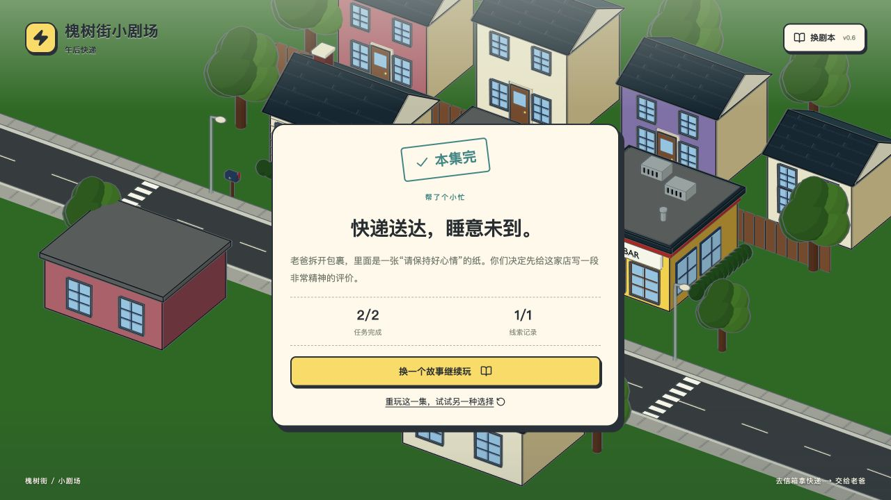
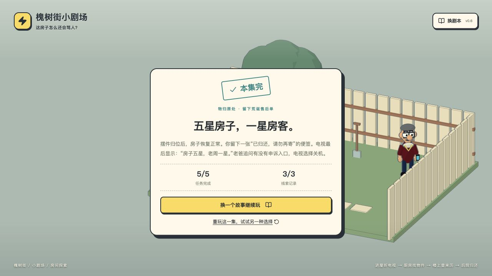
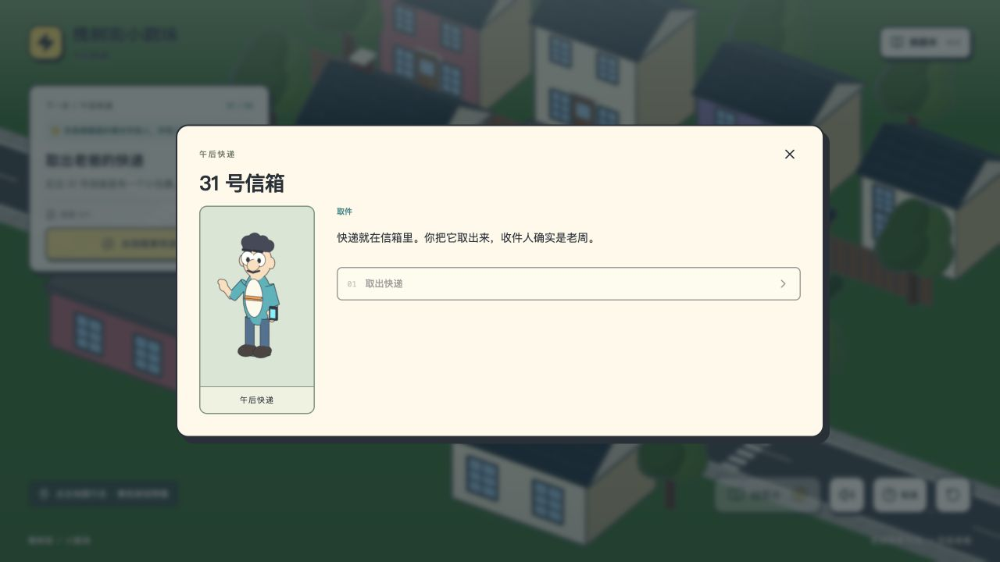

# 用户剧本上传效果检查

日期：2026-11-09。版本：0c84b784。测试地址：http://127.0.0.1:5191/，与线上相同源码，独立本地浏览器存储。未修改线上剧本或玩家存档，也未改动游戏代码。

## 结论

JSON 剧本能被导入并驱动现有游戏：标题、介绍、人物标签、任务、线索、对白、条件分支、结局和独立进度有效。它是现有舞台上的数据化故事系统，不是上传任意小说后自动生成角色、房间和动作的系统。

## 实际浏览器验证

| 项目 | 实际结果 |
| --- | --- |
| JSON 文件选择 | 通过真实文件选择器导入「我的第一集-模板.json」和「闹鬼房屋-完整示例.json」，均出现结构预览 |
| 短篇游玩 | 午后快递从开场、提前找老爸受阻、取件、交付到结局完整通关；2/2 任务、1/1 线索 |
| 房屋游玩 | 自定义 my-haunted-house 从家门进入客厅，听留言、处理冰箱、拿摆件、上楼核对照片、走错后重试、后院选择便签结局；5/5 任务、3/3 线索 |
| 刷新续玩 | 快递已取得后刷新，下一步仍是交给老爸，未丢线索 |
| 多集隔离 | 两份导入剧本均保留各自完成状态；内置三集仍显示尚未开始 |
| 同 ID 更新 | 更新标题后使用新版本初始状态；再导入原版立即恢复原版通关存档 |
| 导出 | 下载 starter-delivery JSON，解析后与原始文件的内容完全一致 |
| 错误格式 | 粘贴普通故事文字时显示 JSON 错误，不进入游戏 |
| 浏览器控制台 | 本轮本地实际浏览器无 error / warn |

## 问题与限制

### 1. 高优先级：结构检查不检查可通关性

复现：在最小模板中给「取出快递」这个唯一取得 parcel 的选项加上 requires: {type: clue, id: parcel}，新 id 为 qa-locked-parcel。该文件显示「剧本结构检查通过」，但进入信箱后唯一选项禁用；尚未取得快递，之后也没有其他取得途径，结局不可达。页面目前明确提示结构检查后仍须试玩，因此这是校验能力的缺口，而非已有通关保证失效。

影响：普通作者容易把条件写反或造成循环依赖，仅凭绿色预览不能确认剧本可玩。建议增加有状态数量上限的通关分析，区分「已找到通关路径」「存在不可达结局」「分析范围不足」；不得在未穷尽时声称全部不可达。

涉及位置：src/components/story/StoryLibrary.tsx:11，src/game/validate.ts:103。

### 2. 中优先级：上传示例未继承最近的玩家引导

playerTask 和 playerDialogue 的额外提示仅对 haunted-house 生效；导入文件必须使用独立 id，完整房屋示例使用 my-haunted-house。实际上传后没有「这一步，怎么判断」面板；开场选项仍写「进家门」，但只关闭对白；购物袋文本仍在点击取出前写「你把它装好带走」。自定义房屋拿取后，模型与空袋标签会变化，但不会显示内置集专用的随身物品栏。

建议：把判断说明、反馈和可携带物品元数据纳入通用剧本格式；同步示例文案。避免按任意相似 id 套用内置情节。

涉及位置：src/game/playerExperience.ts:9、33，src/components/story/RoomNavigation.tsx:9，examples/闹鬼房屋-完整示例.json。

### 3. 能力边界：普通文字和资产不能直接变成游戏

仅接收 JSON，复用四个模型与既定场景/交互点；不会自动提取剧本关系、生成新几何、角色、动作、配音或剧情适配。房屋部分可视变化仍绑定 skull / fridge_cooled 等约定标识。预览只显示任务、线索、结局数量，不展示完整流程。剧本和进度存在本机浏览器，分享网址不会把上传内容分享给其他人。

## 自动检查

现有 21 项自动检查全部通过。额外遍历三份实际导入示例：

| 文件 | 唯一状态数 | 可达结局 | 卡死对白 | 结局跳过任务 |
| --- | --- | --- | --- | --- |
| 我的第一集-模板.json | 8 | 1/1 | 0 | 0 |
| 找钥匙-完整示例.json | 73 | 3/3 | 0 | 0 |
| 闹鬼房屋-完整示例.json | 83 | 2/2 | 0 | 0 |
| 循环依赖反例 | 4 | 0/1 | 1 | 0 |

状态遍历不等于真人体验，也不保证任意剧本质量。测试原始数据见 v0.6-import-audit-metrics.json。本轮未测试实体手机、容量满额、文件读取期间连续换文件或关闭窗口的竞态。

