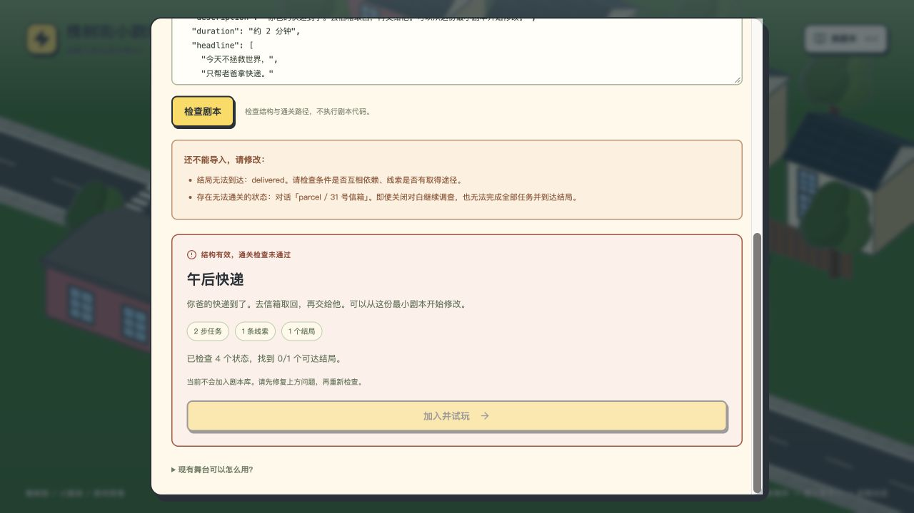
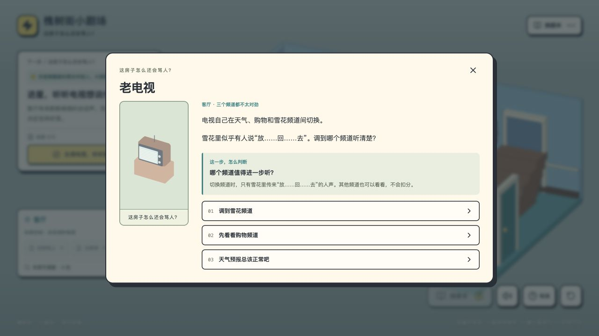
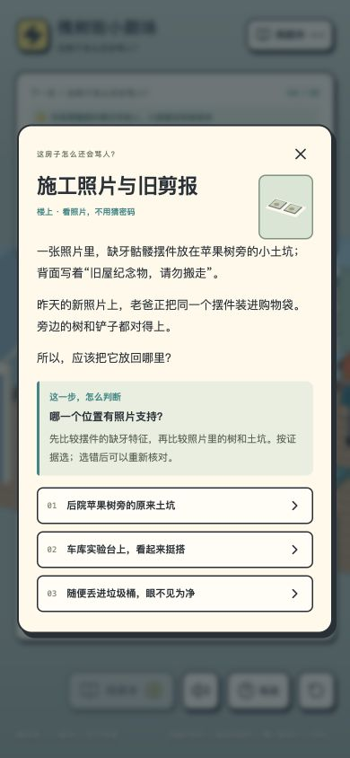

# 剧本导入修复记录 · 2026-11-09

## 修复结果

- 新增有预算、可取消的状态分析。导入顺序为结构验证、通关路径分析、结果预览、加入试玩。
- 检查全部声明结局、提前跳过任务的结束路径、不可恢复的分支。已证实的问题会阻止导入；允许关闭对白后到其他位置补线索的暂时禁用选项。
- 超过 6,000 状态、80,000 转换或 1.8 秒预算时显示未完成，仅提供明确的试演入口，不会错误地承诺通过或声称无解。达到预算前发现的提前结束问题仍会阻止导入。
- 编辑、切换文件或关闭导入窗口取消过期分析，避免旧检查覆盖新草稿。
- 所有 ID 的剧本支持可选对白 judgment，含 question / evidence / 可选 label；物品线索支持 itemLabel，实际拿取后在房屋导航和线索本显示。
- 导入页增加「填入房屋示例」。更新房屋与快递模板，区分关闭对白、移动、观察和真正拿取；不按自定义 ID 套用内置剧情。

## 验证

29 项自动检查全部通过。新增检查包括循环依赖、可通关分支之外的不可逆陷阱、可以撤销的分支、可关闭后取证的禁用对白、提前结束、不可达结局、预算与取消、任意自定义 ID 的判断和物品字段，以及模板文本一致性。

三份完整内置故事和三份导入示例、最小模板均通过全部状态分析。内置三集 JSON 未变，存档版本键兼容；更新导入模板因内容变化使用独立版本，原导入存档保留。

实际浏览器（本地独立存储）重新验证：

1. 用真实文件选择器上传循环依赖反例：显示不可达结局，并定位 parcel / 31 号信箱；导入按钮禁用。
2. 新房屋示例：检查 83 个状态，找到 2/2 结局；自定义 my-haunted-house 显示判断面板。
3. 房屋全程：电视留言、冰箱、购物袋、书房先选错再重试、后院便签结局；5/5 任务、3/3 线索。
4. 拿取前显示摆件还在袋里；点击取出后才显示随身物品，刷新仍保留。
5. 复杂测试文件达到状态预算，显示尚未完成而非绿色通过；找到部分结局不被当成检查完成。
6. 检查大文件期间换成最小模板，最终保留的是新模板的 8 状态、1/1 结局结果。
7. 390 × 844 模拟手机布局，判断和三个选项可读，无水平溢出。非实体手机测试。
8. 生产构建再次上传卡关文件，正确阻止；本地生产控制台无 warning / error。

类型检查与 GitHub Pages 构建通过。保留原有 Three.js 主包体积提示。此分析验证引擎状态可达性，不评估文案质量、证据公平性、3D 资产或无限重复选择的终止性。普通故事文字仍需先改成 JSON；不包含自动生成新模型或房间。

