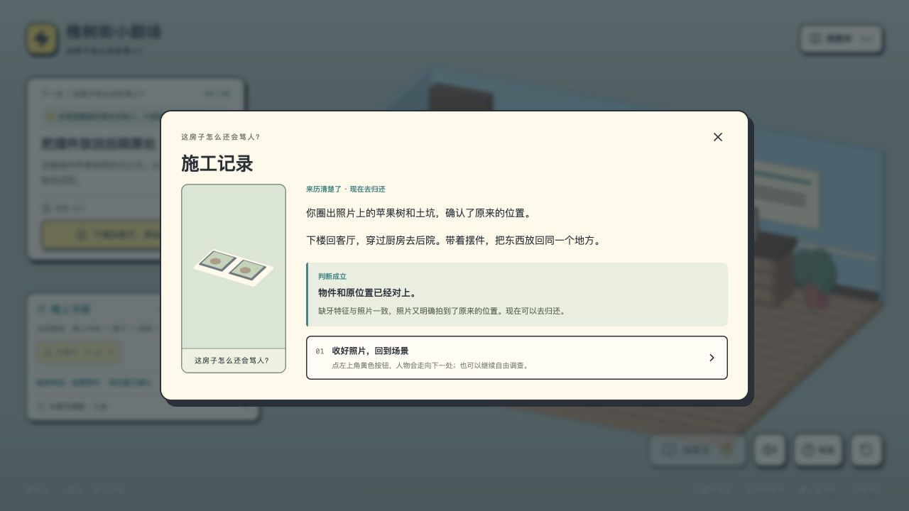
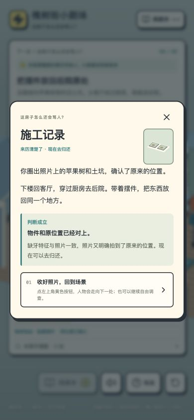

# 玩家体验逐步评审 · 2026-11-07

本轮使用 design-quest-structure 与 design-player-choice 的方法，沿“动机 → 行动 → 信息 → 判断 → 反馈”检查默认房间故事。以下是代理在实际浏览器中的体验评审，不代表真实玩家访谈或用户测试。

| 步骤 | 从玩家角度的判断 | 已更新内容 |
| --- | --- | --- |
| 开场进入房间 | 目标和身份可理解；旧按钮承诺进入房间却只关闭对白，反馈不准确。 | 改为回到家门口，并说明黄色按钮才会带角色移动。 |
| 电视听留言 | 适合作为入门观察题；旧任务卡提前给出答案。 | 先提示观察电视；交互时才呈现人声证据。购物、天气分支仍可安全尝试。 |
| 处理冰箱 | 抱怨和热汤之间的因果清楚，可保留喜剧式试错。 | 展示处理原因的判断依据，明确拔插头后可重选；解决后给出行动反馈。 |
| 购物袋拿取 | 泥土与后院旧物有关联，但需要区分看见与拿到。 | 拿取前明确还在袋中；点击后取得线索，显示随身物品与空袋标签。 |
| 书房核对照片 | 特征和地点都有明确证据，适合轻量调查；题目难度较低。 | 说明比较缺牙、树和土坑；错误解释缺少什么证据，正确解释对应关系。 |
| 穿过房间与提前探索 | 多次往返容易迷路；不应要求已完成的内容重做。 | 增加完整房间路线和下一扇门，区分任务与自由调查；后院只列尚缺的要求。 |
| 后院收场 | 归还位置是证据题，收场方式是表达偏好，不宜混为对错。 | 明确两种选项都能解除闹鬼，提前说明认真道歉与荒诞售后的不同。 |
| 线索与完成反馈 | 未知线索直接给出来源会泄题；遮住的提示容易过期。 | 来源改成可主动展开的位置提示；线索提示在对白和面板关闭后保留可读时间。 |

## 验证

- 21 项自动检查全部通过，涵盖每集结局、存档、导航、绑定资产、音效和本轮引导逻辑。
- 实际浏览器走通默认故事：购物频道 → 留言 → 拔插头 → 重新处理热汤 → 拿取 → 提前去后院 → 补核照片（先错后对）→ 归还并道歉。
- 提前到后院时，仅显示尚缺的照片调查；线索维持 2/3。刷新后保留房间、线索、物件标签和目标。
- 390 × 844 桌面模拟手机尺寸检查：判断面板与选项可见，页面无水平溢出。未在实体手机上测试。
- 未修改故事定义与版本键，已有存档继续使用。保持三渲二、大场景镜头和现有声音设置。
- 仍是短篇线性喜剧探索，照片题主要检验阅读与对应，尚非复杂推理游戏。

