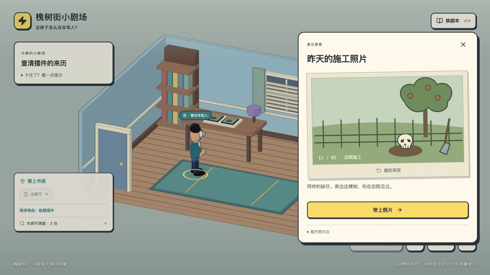
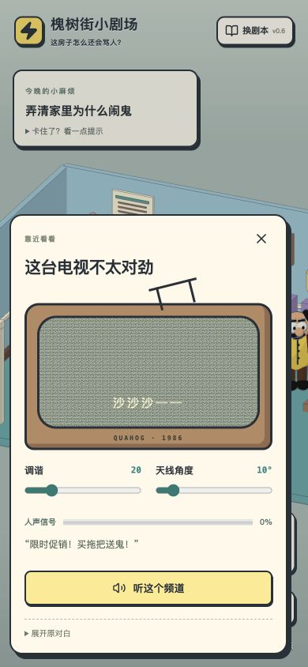
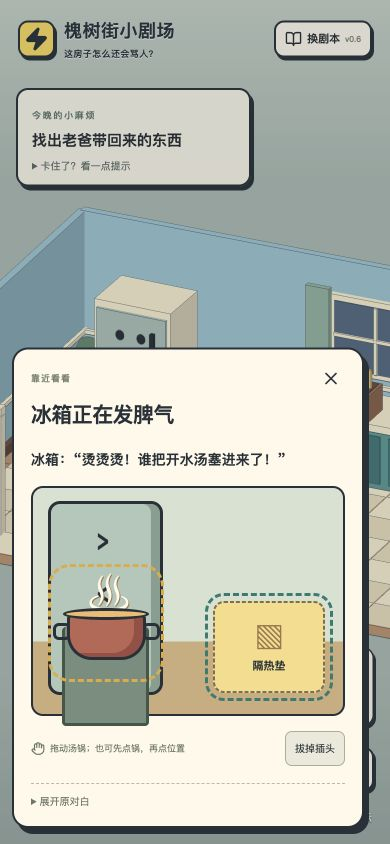

# 闹鬼房子：减少阅读、增加操作

2026-11-09

## 设计判断

原版在目标卡、对白、选项提示和判断面板重复给答案，玩家只需按顺序点。此次优先减少重复解释，让玩家观察反馈、操作物件、收取证据。主线仍为短篇线性调查，不把增加滑块或翻照片等同于完成可玩性设计。

采用 design-player-choice 的意图、信息公平和及时反馈流程。

| 情境 | 玩家意图 | 信息与操作 | 反馈 | 保留状态与后果 |
| --- | --- | --- | --- | --- |
| 电视杂音 | 寻找异常声音，也可以乱听频道 | 两个可调滑块与连续信号强度，无需猜密码 | 雪花减少、残缺字幕变清楚；弱信号出现短恶搞广告 | 清晰收听并确认后才获得 message，不改变原图 |
| 冰箱抱怨 | 处理热源，或先断电止吵 | 可见冒汽汤锅、隔热垫和插头；拖动或点选 | 断电有吐槽；断电后移锅还需接电；完成后 3D 冰箱停止晃动 | 仅恢复通电且移锅后设置 fridge_cooled |
| 购物袋 | 翻找旧物或看杂物 | 可直接点物件，不先解释哪项正确 | 薯片、手套各有短反应；拿摆件即返回房间 | 实际拿取才得到 skull；场景摆件消失，随身物品出现 |
| 施工照片 | 对照摆件与原位置 | 看图、翻背面，不再回答已写出答案的地名选择题 | 图中缺牙摆件、苹果树、土坑和背面便签 | 带上照片获得 origin，返回屋里继续走 |
| 归还 | 让老爸认错，或留下荒诞售后单 | 前面的证据已取得；两种表达都可结束 | 两个不同结局 | 沿用原结局，不增加伪装成策略的随机惩罚 |

调频和搬汤是观察、操作任务，有意存在可理解的完成条件；结尾是表达选择。此次未新增资源取舍、大分支或独立剧情，不能声称解决了所有“没意思”的问题。

## 实现范围

- 新游戏直接进入客厅，省去开场对白；旧存档继续有效。
- 默认一句目标，无步骤数字、答案说明或强制路线。需要时展开提示，显示原任务与自动带路。切换任务后收起提示。
- 调频、搬汤、翻袋和照片使用独立交互面板；通过原引擎的 choose 效果提交状态，维护原始前置条件、两种结局和保存键。
- 重复调查、其他人物和可选恶搞使用一句短对白；原文可展开。
- 导入剧本继续使用原通用播放器，判断提示默认收起。不会未经改编套入内置小游戏。
- 本轮没有编辑 Blender 网格，也没有新增外部美术或配音。

## 验证结果

31 项自动检查通过，包括新增的操作路径、两种结局、前置条件、刷新序列化、外部故事隔离、连续信号反馈与有效调谐区间。类型检查和生产构建通过；保留原有大包体提示。

真实浏览器本地独立存储验证：

1. 首次进入客厅无开场对白，默认提示收起、目标无高亮。
2. 低信号收听显示短广告，不产生线索；两项调节后信号变清晰，确认收听获得第 1 条线索。
3. 先拔电源，再将锅从冰箱拖到垫子，要求接回插头；接电后关掉交互，冰箱恢复正常。
4. 翻袋查看杂物不推进任务；拿摆件后刷新，物品、线索、冰箱和房间都保留。
5. 查看照片正反面、带上照片，再通过相邻房门走到后院，完成便签结局：5/5 任务、3/3 线索。
6. 390 × 844 模拟手机下调频可完成；汤锅可先点选、再点垫子完成。画面无横向溢出。非实体触屏测试。
7. 浏览器控制台无 error / warn。测试后恢复常规视口。

