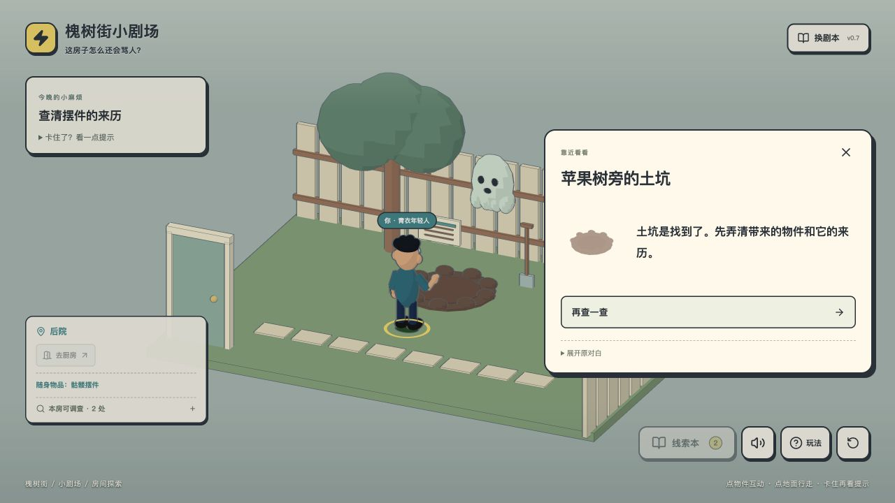
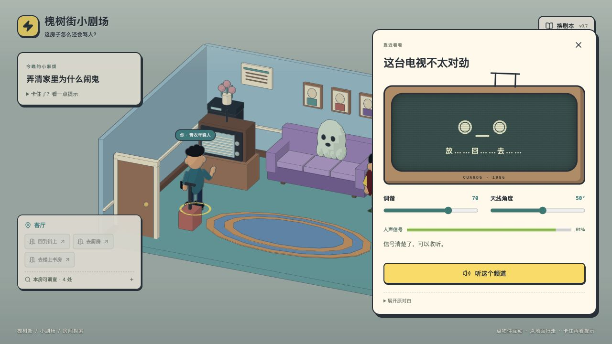

# v0.7 玩家路径复盘

2026-11-09。使用与线上一致的生产构建，在独立浏览器存储中从头玩「这房子怎么还会骂人？」。没有展开任务提示或原对白，没有改存档、跳房间或直接调用游戏函数；这是作者代理的启发式试玩，不是陌生玩家测试，也不能据此估计真实通关时间。

## 结果

完成「鬼走了，老爸留下检讨。」结局，5/5 任务、3/3 线索。浏览器控制台无 error / warn。主线可完成，没有死锁。当前仍未达到有足够探索、推理和选择后果的体验。

| 阶段 | 本次实际行为 | 玩家视角判断 |
| --- | --- | --- |
| 首次打开 | 在剧本库选第 3 集，再点开始 | 入口多一次确认，且剧本库预先泄露了调查路线；小修已去掉自动弹库 |
| 客厅 | 先调查异常沙发，再问老爸 | 场景能吸引注意，沙发与人物只提供一次性笑话，没有改变后续局面 |
| 早到厨房 | 老爸说摆件在厨房，于是直接过去；冰箱拒绝互动，要求先听电视 | 合理推断被固定顺序驳回，是最明显的自由探索障碍，尚未改动这条剧情依赖 |
| 调频 | 调谐从 20 到 50、80、100，再回到 70；天线从 10 到 45；83% 时听不清，再微调到 50 后可听清 | 连续反馈能支持试探，较其他环节更有操作过程；临界状态说明不够明确，已补充「再微调」和「可以收听」；关闭后重置的摩擦已修 |
| 厨房取物 | 先翻袋受阻，转去把锅移到垫子，再看手套、取摆件 | 搬汤的因果容易理解，但动作一次就完成；手套只给一句描述，不能收取、组合或用于取证；只有摆件被标出「拿起来」也让答案很明显 |
| 提前到后院 | 听邻居明确说是老爸从坑里拿的东西，再调查土坑 | 已有摆件和目击信息仍不算完成原位置取证；系统只认可照片，人物信息与游戏规则脱节，列为 P1 设计问题 |
| 楼上照片 | 问阿岚、打开相册、翻背面、带照片 | 看图减少阅读，但玩家没有参与对照或做判断；「带上照片」自动确认了原位置，仍接近领取通行证 |
| 往返后院 | 后院 → 厨房 → 客厅 → 书房 → 客厅 → 厨房 → 后院 | 多次走已见过的房间，没有新增变化或事件，后半程节奏变空 |
| 结尾 | 选择叫老爸道歉，完成归还 | 结局能完成收尾，和便签结局的差别主要是表达与文案，缺少可见的不同演出、人物回应或后续变化 |

## 本轮小修与复测

1. 首次打开直接显示当前故事开始页，保留右上角主动换剧本入口。新存储复测仅一次「开始」即可进入客厅。
2. 调谐值和天线角度提升到当前游戏会话：关闭电视再打开保留；重开本集或切换故事重置。没有把未完成操作当成线索保存，刷新页面仍可能丢失未提交的调谐值。
3. 接近清晰时提示微调，达到可听区间显示可收听。复测 70 / 45 关闭重开仍保留 83%；调整天线至 50 显示 91% 和可收听。
4. 修正冰箱提前对白、购物袋、相册提前对白和阿岚的关闭按钮，写明回到所在房间，避免暗示自动移动或已经借到照片。

31 项自动检查、类型检查、生产构建通过。本轮没有重写主线、修改剧情状态定义或使旧存档失效。

## 下一轮优先级

**P1：允许合理顺序。** 早到厨房应能处理热汤；邻居目击和照片应提供可区分但可利用的信息，而非只认可必经路线。若允许不同证据路径，需要同步重写线索来源、任务完成条件、存档兼容与两种结尾，不能只把几处锁去掉。

**P1：增加一个贯穿多个房间的实际问题。** 让玩家基于观察使用或组合物件，尝试之后改变可用策略；目前主要是单屏操作之后领取下一处门票。

**P2：让结尾和途中行为相连。** 老爸是否配合、家具是否再捣乱等表现应回应玩家此前的办法。两句不同的结束文案不足以支持重玩。

目标是增加玩家能理解的因果与试验空间，不靠更多文字、更隐蔽的按钮或无依据的惩罚制造难度。

