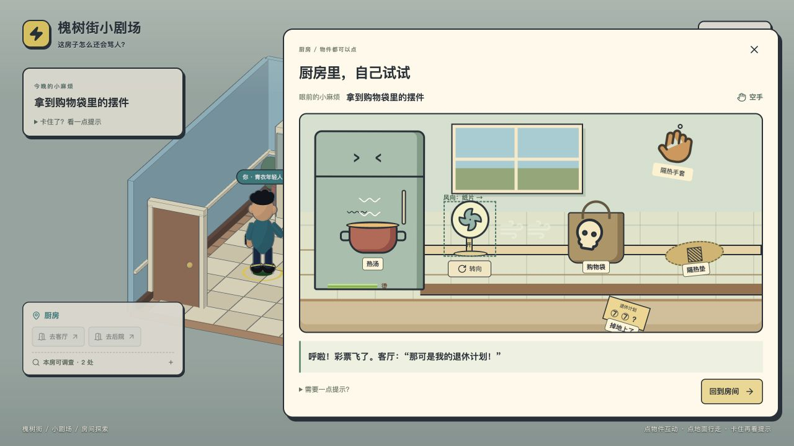
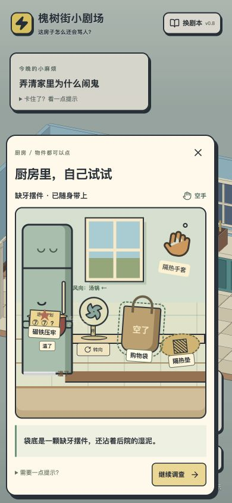
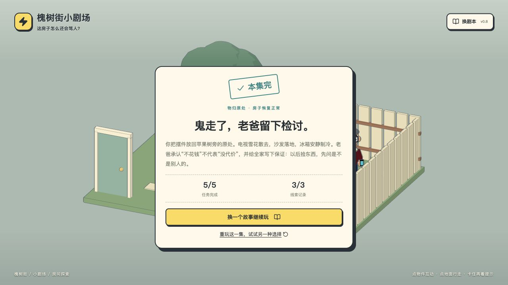

# 厨房小关卡 / 2026-11-10

应用 design-player-choice 和 design-quest-structure。参考《捣蛋鹅》的物件因果、《整蛊邻居》的布置与演出；保留现有三渲二主场景。本轮只做厨房，电视调谐、照片与归还主线保留。

## 任务与动机

玩家想知道老爸带回了什么。购物袋近在眼前，冰箱却不停拍门，因为汤太烫。目标只显示“拿到购物袋里的摆件”。主要动词：观察、试触、拿取、端起、放下、转向、开关、捡回。

| 节拍 | 目标 / 阻力 | 玩家行为 | 可见变化 | 素材与状态 |
| --- | --- | --- | --- | --- |
| 进入厨房 | 拍打的门挡住购物袋 | 观察蒸汽、手套、风向、隔热垫 | 热汤冒气，纸片在风扇前 | 交互台面、3D 对应道具 |
| 试验 | 空手碰锅柄会烫 | 点锅、拿手套、打开或转动风扇 | 缩手音效、手持状态、风线、彩票飞落 | 无扣分或失去关键物品 |
| 解决 | 让冰箱安静 | 端锅放到垫上，或将风对准汤锅 | 锅位置改变，或蒸汽逐渐减少；门安静 | fridge_cooled；记住完成方法 |
| 收尾 | 带走物件 | 拿购物袋里的摆件，可捡回彩票 | 摆件消失，彩票被磁铁压牢 | skull；ticket=returned |
| 后续 | 回客厅 / 继续主线 | 询问老爸、查照片、归还 | 老爸回应彩票是否捡回或戴手套的做法 | 主线结局仍使用原条件 |

## 决策问题与信息

“用工具搬开热汤，还是改变环境让它冷却？”玩家已能看见锅在冒气、手套和垫子，以及风扇的朝向。彩票放在风扇前；检查它会说明只压了半颗花生。后果与物理原因相连，不设隐藏惩罚。提示默认折叠，不列通关步骤。

| 办法 | 意图 | 取舍 | 即时反馈 | 持久状态 | 后续回应 |
| --- | --- | --- | --- | --- | --- |
| 手套端锅到垫上 | 直接用工具处理 | 需要拿、端、放；搬动后暂时占用双手 | 戴上手套、端起锅、锅落在垫上、门停 | mitt、potMoved、method=mitt | 回房间能看见移开的锅，老爸评价戴手套 |
| 风扇对准锅 | 观察并改变环境 | 需要判断风向，约 5 秒主动游戏时间降温；朝纸片会吹飞彩票 | 旋转风叶、风线、蒸汽与温度下降 | heat、fanOn、aim、method=fan | 汤保持原位但不再冒气；彩票状态影响老爸回应 |
| 捡回彩票 | 为自己造成的小混乱善后 | 可选，不锁主线 | 彩票从地上回到冰箱，磁铁压牢 | ticket=returned | 老爸感谢“有投资眼光” |

## 优势检查与制作范围

手套路线刻意更快。此处是低压力物件探索，不是需要严格均衡的竞技策略；风扇路线提供转向试验、渐变反馈与可恢复的喜剧小事故。允许混用物件，保留首次完成方式和彩票最终状态，不为了制造取舍强制没收工具。

两条路线汇合到原购物袋线索，不扩写两套剧情。独立的 kitchen 可选存档字段保存部分温度、手套、端锅、风向、彩票和方法；原剧本定义不改动，旧进度可载入。离开厨房、隐藏页面、打开菜单时停止降温；关闭台面后仍在厨房则继续。刷新从保存温度恢复，不按离线时长直接发奖励。重开本集才清空。

3D 房间增加风扇、手套、彩票、隔热垫与蒸汽，更新锅位置；交互近景负责可点选和触屏操作。减少动态效果时取消晃动、旋转和纸片飞行动画，状态仍可理解。不新增 Blender 资产或外部素材。

## 本轮边界

厨房可在听电视前完成。电视仍提供归还要求，因此归还主线仍要求留言、摆件和位置照片。本轮没有宣称解决照片自动给答案、目击者不算证据、结局主要为文字的问题；这些需要下一轮重写证据结构。

## 验证记录

- 34 项自动检查通过，覆盖两种厨房办法、提前进厨房、空手/双手占用阻挡、部分进度刷新、离房暂停、彩票回收、原两种结局与其他剧本隔离。类型检查和 Pages 构建通过。
- 浏览器实际操作：先不听电视完成手套路线；端锅时刷新后继续放锅、取物成功。重开后用风扇吹落彩票、转向降温、捡回彩票、取摆件，回客厅看到老爸的对应回应；接续电视、照片和归还，完成道歉结局，5/5 任务、3/3 线索。
- 390 × 844 视口下实际点选彩票和购物袋，主要物件与关闭/返回入口均可用；复测后恢复默认视口。
- 最终生产包在独立端口从新存储打开，手套路线取物、刷新恢复通过，控制台无警告或错误。开发页面曾因热更新改变 effect 依赖数组长度产生开发警告，最终包不受影响。
- 这是一版小关卡原型；没有据此宣称已证明陌生玩家觉得有趣。

